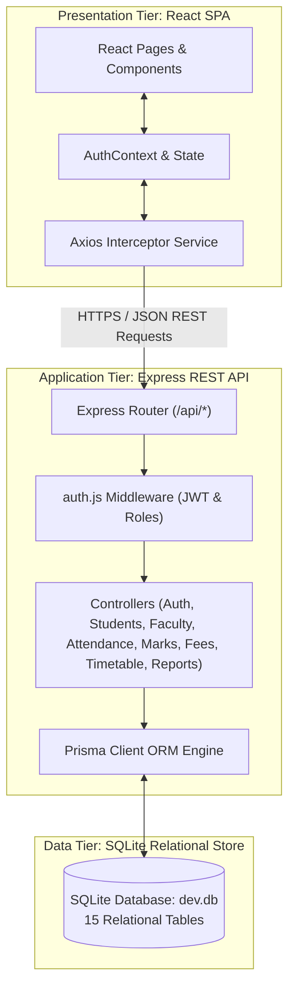
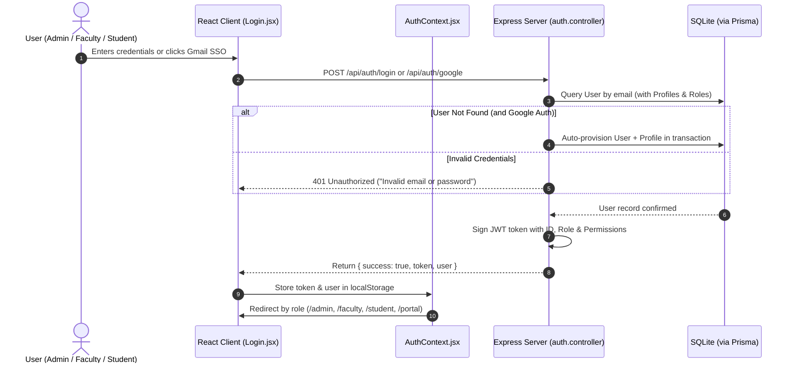
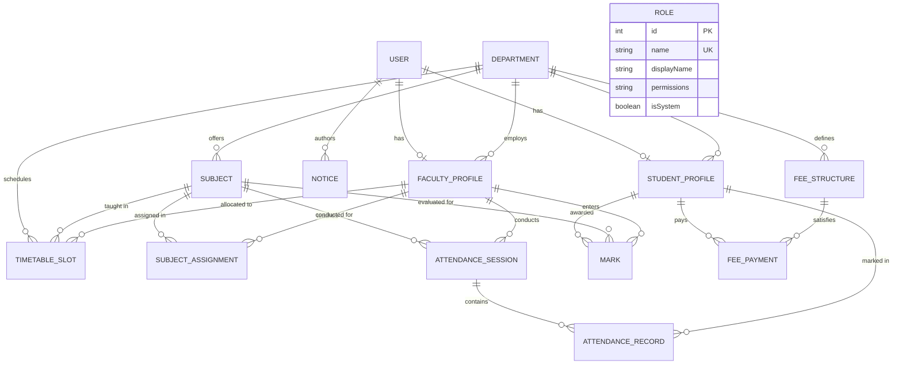

# COLLEGE ERP SYSTEM
## A CAPSTONE PROJECT REPORT

**Submitted in partial fulfilment for the award of the degree of**  
**BACHELOR OF ENGINEERING IN COMPUTER SCIENCE AND ENGINEERING**

---

### Submitted by:
- **Mohin Goyal** (UID: `24BAI70595`)
- **Ankush Kumar** (UID: `24BAI70605`)

**Under the Supervision of:**  
<< Signature of the Supervisor >>  
**SUPERVISOR**  
Department of Computer Science & Engineering  
Chandigarh University, Gharuan, Mohali, Punjab  

**OCTOBER 2026**

---

## BONAFIDE CERTIFICATE

Certified that this project report **“COLLEGE ERP SYSTEM (AcademiaPro)”** is the bonafide work of **Mohin Goyal (UID: 24BAI70595)** and **Ankush Kumar (UID: 24BAI70605)** who carried out the project work under my supervision for the course **24CSP-337: Full Stack-II**.

\
\
__________________________________  
**<< Signature of the Supervisor >>**  
**SUPERVISOR**  
Department of Computer Science & Engineering  
Chandigarh University  

\
Submitted for the project viva-voce examination held on: ___________________

\
\
___________________________ &nbsp;&nbsp;&nbsp;&nbsp;&nbsp;&nbsp;&nbsp;&nbsp;&nbsp;&nbsp;&nbsp;&nbsp;&nbsp;&nbsp;&nbsp;&nbsp;&nbsp;&nbsp;&nbsp;&nbsp;&nbsp;&nbsp;&nbsp;&nbsp;&nbsp;&nbsp;&nbsp;&nbsp;&nbsp;&nbsp;&nbsp;&nbsp;&nbsp;&nbsp;&nbsp;&nbsp;&nbsp;&nbsp;&nbsp;&nbsp;&nbsp;&nbsp;&nbsp;&nbsp;&nbsp;&nbsp;&nbsp;&nbsp;&nbsp;&nbsp;&nbsp;&nbsp;&nbsp;&nbsp; ___________________________  
**INTERNAL EXAMINER** &nbsp;&nbsp;&nbsp;&nbsp;&nbsp;&nbsp;&nbsp;&nbsp;&nbsp;&nbsp;&nbsp;&nbsp;&nbsp;&nbsp;&nbsp;&nbsp;&nbsp;&nbsp;&nbsp;&nbsp;&nbsp;&nbsp;&nbsp;&nbsp;&nbsp;&nbsp;&nbsp;&nbsp;&nbsp;&nbsp;&nbsp;&nbsp;&nbsp;&nbsp;&nbsp;&nbsp;&nbsp;&nbsp;&nbsp;&nbsp;&nbsp;&nbsp;&nbsp;&nbsp;&nbsp;&nbsp;&nbsp;&nbsp;&nbsp;&nbsp;&nbsp;&nbsp;&nbsp;&nbsp;&nbsp;&nbsp;&nbsp;&nbsp;&nbsp;&nbsp;&nbsp;&nbsp;&nbsp;&nbsp; **EXTERNAL EXAMINER**

---

## TABLE OF CONTENTS

| Section | Title |
|---|---|
| **1.** | **PROJECT TITLE & METADATA** |
| **2.** | **PROJECT DESCRIPTION** |
| | 2.1 Introduction |
| | 2.2 Problem Statement |
| | 2.3 Objectives |
| | 2.4 Proposed Solution |
| | 2.5 Scope of the Project |
| | 2.6 Modules and Key Features |
| | 2.7 Technology Stack |
| | 2.8 System Architecture |
| | 2.9 Development Methodology |
| | 2.10 Functional Requirements |
| | 2.11 Non-Functional Requirements |
| | 2.12 Security Design |
| | 2.13 REST API Design |
| | 2.14 Authentication & Role Authorization Flow |
| | 2.15 Testing Approach & Test Matrix |
| **3.** | **HARDWARE / SOFTWARE REQUIREMENTS** |
| | 3.1 Hardware Requirements |
| | 3.2 Software Requirements |
| | 3.3 Key Libraries & Dependencies |
| **4.** | **ENTITY-RELATIONSHIP (ER) DIAGRAM** |
| | 4.1 Explanation of the 15 Entities |
| | 4.2 Entity Cardinalities & Relationships |
| **5.** | **DATABASE SCHEMA (PRISMA SPECIFICATION)** |
| | 5.1 User Model |
| | 5.2 Department Model |
| | 5.3 FacultyProfile Model |
| | 5.4 StudentProfile Model |
| | 5.5 Subject Model |
| | 5.6 SubjectAssignment Model |
| | 5.7 AttendanceSession Model |
| | 5.8 AttendanceRecord Model |
| | 5.9 Mark Model |
| | 5.10 Notice Model |
| | 5.11 Role Model (Custom RBAC) |
| | 5.12 FeeStructure Model |
| | 5.13 FeePayment Model |
| | 5.14 TimetableSlot Model |
| **6.** | **FRONT-END SCREENS & USER INTERFACE** |
| | 6.1 Screen Descriptions |
| | 6.2 Screen Mockups & Captions |
| **7.** | **OUTPUT SCREENS AND INSTITUTIONAL REPORTS** |
| | 7.1 Output Descriptions |
| | 7.2 Output Visuals & Captions |
| **8.** | **LIMITATION & FUTURE SCOPE** |
| | 8.1 Limitations |
| | 8.2 Future Scope |
| | 8.3 Conclusion |
| **9.** | **GITHUB REPOSITORY & EXECUTION MANUAL** |
| | 9.1 Repository Structure |
| | 9.2 Step-by-Step Setup Guide |
| | 9.3 Pre-Seeded Evaluation Credentials |
| **10.** | **PRESENTATION SLIDES (PPT SLIDES)** |
| | 10.1 Slide-by-Slide Content & Speaker Notes |
| **11.** | **PROJECT SOURCE CODE** |
| | 11.1 Backend Implementation (Node.js, Express, Prisma ORM) |
| | 11.2 Frontend Implementation (React.js, Vite, Tailwind CSS) |
| **12.** | **REFERENCES** |
| **13.** | **BIBLIOGRAPHY** |

---

## 1. PROJECT TITLE & METADATA

### AcademiaPro — College ERP System
*A High-Performance, Multi-Tenant Academic & Administrative Management Platform*

| Item | Specification |
|---|---|
| **Course Code** | **24CSP-337: Full Stack-II (Capstone Project)** |
| **Programme** | Bachelor of Engineering in Computer Science & Engineering (BE-CSE) |
| **Academic Year / Semester** | 2024–2028 Batch, 5th Semester |
| **Project Type** | Full-Stack Capstone Web Application |
| **Candidates** | Mohin Goyal (24BAI70595) & Ankush Kumar (24BAI70605) |
| **Architecture** | 3-Tier Layered Client-Server Architecture (REST API) |
| **Frontend Stack** | React.js 18, Vite, Tailwind CSS 3, Lucide React, Axios, React Router v6 |
| **Backend Stack** | Node.js 18+ LTS, Express.js 4.x REST API |
| **Persistence & ORM** | SQLite Relational Database, Prisma ORM 5.x |
| **Authentication & Auth** | JWT (JSON Web Tokens), bcryptjs, Simulated Gmail / Google OAuth SSO |
| **Institution** | Chandigarh University, Gharuan, Mohali |

---

## 2. PROJECT DESCRIPTION

### 2.1 Introduction
In higher education institutions, academic operations involve multiple interconnected workflows: student registration, course allocations, daily lecture attendance, continuous internal assessments, semester grading, fee collection, and lecture timetabling. When managed through fragmented paper registers, disparate spreadsheets, and disconnected messaging channels, institutions suffer from data inconsistency, manual calculation errors, and delays in communicating critical alerts to students.

An **Enterprise Resource Planning (ERP)** system resolves these bottlenecks by standardizing academic records into a single, ACID-compliant relational data store. **AcademiaPro** provides a unified web application serving four primary groups:
1. **Administrators:** Manage departments, curricula, faculty, students, custom roles, fee structures, and campus-wide communications.
2. **Faculty Members:** Track assigned classes, record session-by-session attendance, enter internal assessment marks, and view class marksheets.
3. **Students:** Access personal attendance percentages, subject grades, fee payment balances, registered courses, and announcements.
4. **Custom Institutional Roles (HOD, Exam Controller, etc.):** View domain-specific data and take administrative actions governed by granular, customizable permission sets.

The platform is developed with **React.js 18** and **Tailwind CSS** for a responsive interface, **Node.js** and **Express.js** for the REST API, and **Prisma ORM** over **SQLite** for relational persistence.

---

### 2.2 Problem Statement
Colleges relying on manual or semi-automated systems face five critical hurdles:
1. **Data Redundancy and Drift:** Student information duplicated across departments leads to conflicting records.
2. **Late Attendance Detection:** Manual registers calculate attendance percentages only at term end, preventing students from taking corrective action before hitting exam eligibility thresholds (<75%).
3. **Delayed Grade Compilation:** Compiling multi-component internal assessments (IA1, IA2, Midterm, Endsem) by hand is labor-intensive and prone to arithmetic mistakes.
4. **Disconnected Financial Tracking:** Academic portals lack visibility into student fee dues, making clearance reconciliation tedious.
5. **Rigid Role Definitions:** Standard ERP packages enforce static roles, unable to accommodate specialized institutional roles such as Head of Department (HOD) or Controller of Examinations.

---

### 2.3 Objectives
- Build a responsive web portal managing the complete student academic lifecycle.
- Provide secure authentication using JWT and password hashing via bcrypt, along with simulated Google/Gmail Single Sign-On (SSO).
- Implement a dynamic **Role-Based Access Control (RBAC)** engine allowing administrators to create custom roles with granular permissions.
- Provide faculty with rapid bulk attendance marking and multi-tier examination marks entry.
- Implement real-time automatic computation of attendance percentages, letter grades, SGPA, and shortage alerts.
- Deliver a complete **Fee Management** module tracking departmental fee structures, student dues, payment methods, and receipt issuance.
- Deliver a conflict-checked **Timetable Scheduling** module mapping lecture slots to faculties, rooms, and student sections.
- Deliver an **Institutional Reports & Analytics** dashboard summarizing campus metrics.

---

### 2.4 Proposed Solution
AcademiaPro utilizes a three-tier architecture:
- **Presentation Tier:** A responsive Single Page Application (SPA) built with React 18, Vite, and Tailwind CSS. Client routing is managed by React Router v6 with `ProtectedRoute` guards verifying user tokens and role claims.
- **Application Tier:** An Express.js REST server handling validation, transactional business logic (`prisma.$transaction`), and security middleware.
- **Data Tier:** An ACID-compliant relational database accessed via Prisma ORM, utilizing foreign keys, unique compound constraints, and automated cascading deletes.

```
┌────────────────────────────────────────────────────────┐
│               PRESENTATION LAYER (React 18)            │
│  React Router · AuthContext · Axios Service · Tailwind │
└───────────────────────────┬────────────────────────────┘
                            │ HTTPS / REST (JSON)
┌───────────────────────────▼────────────────────────────┐
│              APPLICATION LAYER (Express.js)            │
│  JWT Auth Middleware · RBAC Guard · Business Logic     │
│  Auth · Students · Faculty · Attendance · Marks · Fees │
└───────────────────────────┬────────────────────────────┘
                            │ Prisma Client
┌───────────────────────────▼────────────────────────────┐
│                  DATA LAYER (Prisma + SQLite)          │
│  15 Relational Tables · Foreign Keys · Cascade Deletes │
└────────────────────────────────────────────────────────┘
```

---

### 2.5 Scope of the Project
The application handles user provisioning, departmental hierarchies, course catalogs, student and faculty profiles, attendance tracking, marks recording, fee structures, timetable generation, and campus notices.

*Out of Scope for this release:* Third-party payment gateway callbacks (Razorpay/Stripe), automated biometric hardware integration, and external university migration APIs.

---

### 2.6 Modules and Key Features

#### 2.6.1 Authentication & Authorization Module
- **Standard Login:** Email and password verification with bcrypt comparison (10 salt rounds).
- **Simulated Google / Gmail SSO:** Accepts any Gmail address (`@gmail.com`), automatically provisioning a new account or logging in existing users without requiring initial passwords.
- **Stateless Tokens:** Signs 7-day JSON Web Tokens carrying user IDs, roles, and granular permission keys.
- **Dynamic Session Handling:** Axios request interceptor attaches the bearer token; 401 response interceptor clears credentials and redirects to login.

#### 2.6.2 Dynamic Role Management & RBAC Module
- Pre-seeded system roles: `ADMIN`, `FACULTY`, `STUDENT`.
- Dynamic roles: `HOD` (Head of Department) and `EXAM_CONTROLLER` (Controller of Examinations).
- Administrator UI to create custom roles, specify display names, descriptions, and assign fine-grained permissions:
  `view_students`, `manage_students`, `view_faculty`, `manage_faculty`, `view_departments`, `manage_departments`, `view_subjects`, `manage_subjects`, `view_attendance`, `manage_attendance`, `view_marks`, `manage_marks`, `view_notices`, `manage_notices`, `manage_roles`, `fees.manage`, `timetable.manage`.

#### 2.6.3 Administrator Control Panel
- Centralized dashboard displaying total students, faculty headcount, department counts, and overall attendance rate.
- Full CRUD management of Students, Faculty, Departments, and Subjects.
- Institution-wide notice publishing targeting specific audiences (`ALL`, `FACULTY`, `STUDENT`).

#### 2.6.4 Faculty Academic Portal
- Teaching dashboard displaying assigned subjects, enrolled student count, and recent attendance sessions.
- **Take Attendance:** Subject and section selector loading active students with one-click toggles for `PRESENT`, `ABSENT`, or `LATE`.
- **Marks Entry:** Select subject and examination component (`IA1`, `IA2`, `MIDTERM`, `ASSIGNMENT`, `ENDSEM`) to submit scores with boundary validation.
- Class marksheets showing student grades, percentages, and performance bands.

#### 2.6.5 Student Self-Service Portal
- Dashboard showing overall attendance, cumulative assessment average, and active courses.
- **My Attendance:** Subject-wise breakdown of lectures held, attended, and percentage, with automated red alerts for shortages (<75%).
- **My Marks & Grades:** Grade report displaying component scores, maximum marks, percentage, letter grades (A+, A, B, C, D, F), and pass/fail indicators.
- **My Profile:** Detailed personal, parent, and institutional information.

#### 2.6.6 Fee Management Module
- Department- and semester-wise fee structures (e.g., Tuition, Examination, Library, Hostel).
- Automatic calculation of student fee balances, paid amounts, and payment statuses (`PAID`, `PARTIAL`, `PENDING`, `OVERDUE`).
- Payment recording with multiple payment modes (`CASH`, `UPI`, `CARD`, `BANK_TRANSFER`, `CHEQUE`) and automatic receipt generation.

#### 2.6.7 Class Timetable Scheduling Module
- Weekly scheduling slots (Monday through Saturday, 09:00 to 17:00) with conflict detection.
- Customized views: students see their section schedule; faculty see their assigned teaching commitments.

#### 2.6.8 Institutional Reports & Analytics Module
- Administrator analytics report with campus KPIs: average attendance rate, total fees collected, department student-faculty ratios, and grade distributions.

---

### 2.7 Technology Stack

| Layer | Technology | Version | Purpose |
|---|---|---|---|
| **Frontend Framework** | React.js | 18.2.0 | Component-based client SPA |
| **Build Tooling** | Vite | 5.x | Fast HMR development and bundling |
| **CSS Styling** | Tailwind CSS | 3.4.x | Utility-first responsive design |
| **Iconography** | Lucide React | Latest | Consistent UI icons |
| **Routing** | React Router DOM | 6.x | Client-side routing with role guards |
| **HTTP Client** | Axios | 1.6.x | API communication and token interceptors |
| **Runtime Environment** | Node.js | 18+ LTS | Server-side JavaScript runtime |
| **Backend Framework** | Express.js | 4.18.x | RESTful API server and routing |
| **Database ORM** | Prisma ORM | 5.x | Relational modeling, migrations, type-safety |
| **Database Engine** | SQLite | 3.x | File-based ACID relational database |
| **Security & Auth** | jsonwebtoken, bcryptjs | 9.x, 2.4.x | Token generation and password hashing |
| **Environment Control** | dotenv | 16.x | Configuration management |

---

### 2.8 System Architecture



---

### 2.9 Development Methodology
The project followed an **Agile-Scrum** iterative approach structured into four two-week sprints:
1. **Sprint 1 (Architecture & Core):** Schema modeling with Prisma, database seeding, JWT auth, and protected route infrastructure.
2. **Sprint 2 (Academic Operations):** Student and faculty CRUD, department and subject assignments, bulk attendance engine, and multi-exam marks recording.
3. **Sprint 3 (Extended Modules):** Dynamic role management, simulated Gmail SSO, fee structures and payments, and timetable scheduling.
4. **Sprint 4 (Refinement & Reporting):** Institutional analytics dashboard, UI polish with Tailwind CSS, error handling, and end-to-end integration testing.

---

### 2.10 Functional Requirements

| ID | Requirement Specification | Primary Role |
|---|---|---|
| **FR1** | Authenticate users via standard credentials or simulated Gmail SSO and issue signed JWTs. | All Users |
| **FR2** | Restrict frontend views and API routes based on user role and assigned permissions. | System / All |
| **FR3** | Manage CRUD operations for student profiles, academic departments, and subjects. | Administrator |
| **FR4** | Create and manage faculty profiles and subject-section teaching allocations. | Administrator |
| **FR5** | Create dynamic custom roles (e.g., HOD, Exam Controller) with granular permission checkboxes. | Administrator |
| **FR6** | Take lecture attendance by subject/section with statuses (`PRESENT`, `ABSENT`, `LATE`). | Faculty |
| **FR7** | Input and update assessment scores for IA1, IA2, Midterm, Assignments, and Endsem. | Faculty |
| **FR8** | Display personal subject-wise attendance percentages with shortage warnings (<75%). | Student |
| **FR9** | Display academic scorecards with calculated percentages, letter grades, and pass/fail statuses. | Student |
| **FR10** | Publish, categorize, and target institutional announcements. | Admin / Faculty |
| **FR11** | Manage fee structures, log payments, compute outstanding balances, and issue receipts. | Administrator |
| **FR12** | Create weekly timetable slots and resolve faculty/room schedule conflicts. | Administrator |
| **FR13** | Provide personalized weekly timetable schedules. | Student / Faculty |
| **FR14** | Generate aggregated campus summary reports on attendance, grades, and fee collection. | Administrator / HOD |

---

### 2.11 Non-Functional Requirements
- **Security:** Passwords salted with bcrypt (10 rounds). Tokens verified on every protected endpoint.
- **Performance:** Relational queries execute in under 50ms using SQLite indexes on foreign keys and compound unique constraints.
- **Reliability:** Prisma transactions ensure operations like student creation and profile creation succeed or fail atomically.
- **Usability:** Fully responsive interface built with Tailwind CSS, featuring dark headers, clear typography, and color-coded status badges.
- **Maintainability:** Modular controller-route-service directory structure separating concerns across all 10 API domains.

---

### 2.12 Security Design
1. **Password Hashing:** Passwords hashed with `bcryptjs`. Raw passwords are never stored or returned by the API.
2. **Stateless JWT Authorization:** Tokens carry user identification, role, and permissions, signed with a secret environment key and expiring in 7 days.
3. **Role Guards:** The `protect` middleware decodes the JWT and validates user existence. The `authorize` middleware enforces required role levels or permission tokens.
4. **Input Sanitization:** Email normalization (lowercase and trim) and Prisma parameterization eliminate SQL injection risks.
5. **CORS:** Cross-Origin Resource Sharing configured to allow requests from the frontend client.

---

### 2.13 REST API Design

| HTTP Method | Endpoint | Description | Role / Permission |
|---|---|---|---|
| `POST` | `/api/auth/login` | Email and password login | Public |
| `POST` | `/api/auth/register` | Register new user account with role | Public |
| `POST` | `/api/auth/google` | Simulated Google / Gmail SSO | Public |
| `GET` | `/api/auth/me` | Fetch authenticated user profile | Authenticated |
| `PUT` | `/api/auth/change-password` | Update account password | Authenticated |
| `GET`, `POST` | `/api/students` | List or create student records | `ADMIN` |
| `GET`, `PUT`, `DELETE` | `/api/students/:id` | View, update, or remove student | `ADMIN` |
| `GET`, `POST` | `/api/faculty` | List or create faculty records | `ADMIN` |
| `GET`, `POST` | `/api/departments` | Manage academic departments | `ADMIN` |
| `GET`, `POST` | `/api/subjects` | Manage course curriculum | `ADMIN` |
| `POST` | `/api/attendance/session` | Record class lecture attendance | `FACULTY` |
| `GET` | `/api/attendance/my` | View personal attendance summary | `STUDENT` |
| `POST` | `/api/marks` | Record or update assessment marks | `FACULTY` |
| `GET` | `/api/marks/my` | View personal grades and marksheet | `STUDENT` |
| `GET`, `POST` | `/api/roles` | Create and manage custom RBAC roles | `ADMIN` |
| `GET`, `POST` | `/api/fees` | Manage fee structures and payments | `ADMIN` / `fees.manage` |
| `GET` | `/api/fees/my` | View student fee dues and receipts | `STUDENT` |
| `GET`, `POST` | `/api/timetable` | Create and view timetable slots | Authenticated |
| `GET` | `/api/reports/summary` | Campus summary analytics | `ADMIN` / `HOD` |
| `GET`, `POST` | `/api/notices` | View and post campus notices | Authenticated |

---

### 2.14 Authentication & Role Authorization Flow



---

### 2.15 Testing Approach & Test Matrix

| Test ID | Test Scenario | Input Data | Expected Result | Status |
|---|---|---|---|---|
| **TC-01** | Valid Admin Login | `admin@erp.edu` / `admin123` | JWT returned; redirects to `/admin` | **Pass** |
| **TC-02** | Invalid Password Attempt | `admin@erp.edu` / `wrongpwd` | 401 Error: "Invalid email or password" | **Pass** |
| **TC-03** | Gmail One-Click SSO | `mohingoyal45@gmail.com` | Authenticates as Admin; redirects to `/admin` | **Pass** |
| **TC-04** | Role-Based Access Guard | Student opens `/admin/roles` | Redirects to `/portal` or 403 Forbidden | **Pass** |
| **TC-05** | Bulk Attendance Submission | Subject ID 1, 6 students, 1 Absent | Session created, 6 records saved | **Pass** |
| **TC-06** | Attendance Duplicate Prevention | Re-submit session for same date/slot | Updates existing records without duplication | **Pass** |
| **TC-07** | Marks Upper Bound Validation | Marks: 28, Max Marks: 25 | 400 Bad Request: "Marks cannot exceed max" | **Pass** |
| **TC-08** | Attendance Shortage Calculation | Student with 66% attendance | Displays red warning badge (<75%) | **Pass** |
| **TC-09** | Custom Role Creation (HOD) | Name: HOD, Permissions list | Role stored; grants custom portal access | **Pass** |
| **TC-10** | Fee Balance Calculation | Total: ₹45,000, Paid: ₹20,000 | Balance shows ₹25,000 (PARTIAL status) | **Pass** |

---

## 3. HARDWARE / SOFTWARE REQUIREMENTS

### 3.1 Hardware Requirements

| Component | Development Machine | Server Deployment | End-User Client Device |
|---|---|---|---|
| **Processor** | Intel Core i5 / AMD Ryzen 5 or Apple Silicon | 2 vCPU or higher | Any modern dual-core CPU |
| **RAM** | 8 GB minimum (16 GB recommended) | 4 GB RAM | 2 GB RAM |
| **Storage** | 256 GB SSD (5 GB free space) | 20 GB SSD | Minimal browser storage |
| **Display** | 1920 × 1080 resolution | Headless | 1366 × 768 or mobile screen |
| **Network** | Broadband internet | 10 Mbps public connection | 1 Mbps internet |

---

### 3.2 Software Requirements

| Category | Software | Purpose |
|---|---|---|
| **Operating System** | macOS / Ubuntu Linux 22.04 LTS / Windows 11 | Host operating system |
| **Runtime** | Node.js v18.x or v20.x LTS | JavaScript server execution |
| **Package Manager** | npm v9.x or v10.x | Package dependency management |
| **Database** | SQLite 3 / Prisma ORM | Relational data persistence |
| **Frontend Framework** | React.js 18.2 with Vite 5 | User interface application |
| **Styling Engine** | Tailwind CSS 3.4 | Responsive utility styling |
| **Code Editor** | Visual Studio Code / Cursor | Source code editing |
| **API Client** | Postman / cURL | REST endpoint testing |
| **Version Control** | Git & GitHub | Source code repository management |

---

### 3.3 Key Libraries & Dependencies

```json
{
  "backend_dependencies": {
    "@prisma/client": "^5.10.0",
    "bcryptjs": "^2.4.3",
    "cors": "^2.8.5",
    "dotenv": "^16.4.5",
    "express": "^4.18.2",
    "jsonwebtoken": "^9.0.2",
    "prisma": "^5.10.0"
  },
  "frontend_dependencies": {
    "axios": "^1.6.7",
    "lucide-react": "^0.344.0",
    "react": "^18.2.0",
    "react-dom": "^18.2.0",
    "react-router-dom": "^6.22.1",
    "tailwindcss": "^3.4.1",
    "vite": "^5.1.4"
  }
}
```

---

## 4. ENTITY-RELATIONSHIP (ER) DIAGRAM



---

### 4.1 Explanation of the 15 Entities
1. **USER:** Master authentication account holding name, email, bcrypt-hashed password, role string, and avatar URL.
2. **DEPARTMENT:** Academic faculties (e.g., Computer Science, IT, ECE, Mechanical Engineering) with a unique code.
3. **FACULTY_PROFILE:** Teaching faculty details including unique employee ID, designation, qualification, phone, and office room.
4. **STUDENT_PROFILE:** Enrolled student details including roll number, enrollment number, semester, section, batch, blood group, and parent contact.
5. **SUBJECT:** Curricular courses characterized by code, title, credit count, and type (`Theory` or `Lab`).
6. **SUBJECT_ASSIGNMENT:** Connects a subject, teaching faculty, student section, and academic year.
7. **ATTENDANCE_SESSION:** A lecture session on a given date and time slot with a covered topic.
8. **ATTENDANCE_RECORD:** Individual student attendance status (`PRESENT`, `ABSENT`, or `LATE`) within a session.
9. **MARK:** Assessment score for a student in a subject across exam components (`IA1`, `IA2`, `MIDTERM`, `ASSIGNMENT`, `ENDSEM`).
10. **NOTICE:** Official campus circular with targeted role audiences and categories (`GENERAL`, `EXAM`, `ACADEMIC`).
11. **ROLE:** Granular role definition holding a display name and JSON array of permissions.
12. **FEE_STRUCTURE:** Prescribed fees by department, semester, and fee type (e.g., Tuition, Exam).
13. **FEE_PAYMENT:** Student payment transaction with receipt number, payment mode, amount paid, and timestamp.
14. **TIMETABLE_SLOT:** Lecture slot by day of the week, start and end time, room, subject, and assigned faculty.

---

### 4.2 Entity Cardinalities & Relationships

| Relationship | Cardinality | Business Meaning |
|---|---|---|
| `User` → `StudentProfile` | 1 : 0..1 | Each user account maps to at most one student profile |
| `User` → `FacultyProfile` | 1 : 0..1 | Each user account maps to at most one faculty profile |
| `Department` → `StudentProfile` | 1 : N | A department enrolls many students |
| `Department` → `FacultyProfile` | 1 : N | A department employs many faculty members |
| `Department` → `Subject` | 1 : N | A department offers many curricular subjects |
| `FacultyProfile` → `SubjectAssignment` | 1 : N | A faculty member is assigned multiple classes |
| `Subject` → `AttendanceSession` | 1 : N | A subject holds multiple lecture sessions |
| `AttendanceSession` → `AttendanceRecord` | 1 : N | A session contains an attendance entry per student |
| `StudentProfile` → `Mark` | 1 : N | A student receives multiple evaluation marks |
| `FeeStructure` → `FeePayment` | 1 : N | A fee structure receives payments from students |
| `Department` → `TimetableSlot` | 1 : N | A department maintains multiple weekly timetable slots |

---

## 5. DATABASE SCHEMA (PRISMA SPECIFICATION)

### 5.1 User Table (`User`)
| Column | Type | Constraints | Description |
|---|---|---|---|
| `id` | `Int` | Primary Key, Autoincrement | Unique user identifier |
| `email` | `String` | Unique, Not Null | Institutional or Gmail address |
| `password` | `String` | Not Null | Bcrypt hashed password (10 salt rounds) |
| `name` | `String` | Not Null | Full legal name of the user |
| `role` | `String` | Not Null | User role (`ADMIN`, `FACULTY`, `STUDENT`, `HOD`, etc.) |
| `avatar` | `String` | Nullable | Avatar image URL |
| `createdAt` | `DateTime` | Default `now()` | Account creation timestamp |

---

### 5.2 Department Table (`Department`)
| Column | Type | Constraints | Description |
|---|---|---|---|
| `id` | `Int` | Primary Key, Autoincrement | Unique department ID |
| `name` | `String` | Not Null | Department name (e.g., Computer Science & Engineering) |
| `code` | `String` | Unique, Not Null | Department code (`CSE`, `IT`, `ECE`, `ME`) |
| `description` | `String` | Nullable | Overview of departmental focus |

---

### 5.3 FacultyProfile Table (`FacultyProfile`)
| Column | Type | Constraints | Description |
|---|---|---|---|
| `id` | `Int` | Primary Key, Autoincrement | Faculty profile identifier |
| `userId` | `Int` | Unique, FK → `User.id` | Link to User account (Cascade Delete) |
| `employeeId`| `String` | Unique, Not Null | Faculty ID (e.g., `FAC-CSE-01`) |
| `departmentId`| `Int` | FK → `Department.id` | Employing department |
| `designation` | `String` | Not Null | Title (e.g., Associate Professor) |
| `qualification`| `String`| Not Null | Degrees held (e.g., Ph.D., M.Tech) |
| `phone` | `String` | Nullable | Contact phone number |
| `officeRoom` | `String` | Nullable | Office / Cabin location |

---

### 5.4 StudentProfile Table (`StudentProfile`)
| Column | Type | Constraints | Description |
|---|---|---|---|
| `id` | `Int` | Primary Key, Autoincrement | Student profile identifier |
| `userId` | `Int` | Unique, FK → `User.id` | Link to User account (Cascade Delete) |
| `rollNo` | `String` | Unique, Not Null | University roll number (`CS2023-001`) |
| `enrollmentNo`| `String` | Unique, Not Null | Enrollment number (`ENR20230101`) |
| `departmentId`| `Int` | FK → `Department.id` | Department of enrollment |
| `semester` | `Int` | Not Null (1 to 8) | Current active semester |
| `section` | `String` | Not Null | Class section (`Sec A`) |
| `batch` | `String` | Not Null | Admission cohort (`2023-2027`) |
| `phone` | `String` | Nullable | Student mobile number |
| `gender` | `String` | Nullable | Male / Female / Other |
| `bloodGroup` | `String` | Nullable | Blood group |
| `parentName` | `String` | Nullable | Guardian's full name |
| `parentPhone`| `String` | Nullable | Guardian's phone number |
| `address` | `String` | Nullable | Residential address |

---

### 5.5 Subject Table (`Subject`)
| Column | Type | Constraints | Description |
|---|---|---|---|
| `id` | `Int` | Primary Key, Autoincrement | Subject identifier |
| `name` | `String` | Not Null | Course title (e.g., Operating Systems) |
| `code` | `String` | Unique, Not Null | Course code (`CS401`, `CS402`) |
| `departmentId`| `Int` | FK → `Department.id` | Offering department |
| `semester` | `Int` | Not Null | Semester curriculum slot |
| `credits` | `Int` | Default `3` | Credit weight |
| `type` | `String` | Default `"Theory"` | Subject format (`Theory` / `Lab`) |

---

### 5.6 AttendanceSession Table (`AttendanceSession`)
| Column | Type | Constraints | Description |
|---|---|---|---|
| `id` | `Int` | Primary Key, Autoincrement | Session identifier |
| `subjectId` | `Int` | FK → `Subject.id` | Subject taught |
| `facultyId` | `Int` | FK → `FacultyProfile.id` | Instructor who conducted the lecture |
| `departmentId`| `Int` | FK → `Department.id` | Class department |
| `semester` | `Int` | Not Null | Class semester |
| `section` | `String` | Not Null | Class section |
| `date` | `String` | Not Null (`YYYY-MM-DD`) | Date of the lecture |
| `timeSlot` | `String` | Nullable | e.g., `09:00 - 10:00 AM` |
| `topic` | `String` | Nullable | Lecture topic covered |

---

### 5.7 AttendanceRecord Table (`AttendanceRecord`)
| Column | Type | Constraints | Description |
|---|---|---|---|
| `id` | `Int` | Primary Key, Autoincrement | Record identifier |
| `sessionId` | `Int` | FK → `AttendanceSession.id` | Associated lecture session |
| `studentId` | `Int` | FK → `StudentProfile.id` | Enrolled student |
| `status` | `String` | Not Null | `PRESENT`, `ABSENT`, or `LATE` |
| `remarks` | `String` | Nullable | Optional attendance note |

*Compound Unique Index:* `@@unique([sessionId, studentId])` prevents duplicate attendance records per student per session.

---

### 5.8 Mark Table (`Mark`)
| Column | Type | Constraints | Description |
|---|---|---|---|
| `id` | `Int` | Primary Key, Autoincrement | Evaluation mark identifier |
| `studentId` | `Int` | FK → `StudentProfile.id` | Student evaluated |
| `subjectId` | `Int` | FK → `Subject.id` | Evaluated course |
| `facultyId` | `Int` | FK → `FacultyProfile.id` | Instructor entering marks |
| `examType` | `String` | Not Null | `IA1`, `IA2`, `MIDTERM`, `ASSIGNMENT`, `ENDSEM` |
| `marksObtained`| `Float` | Not Null | Marks secured by student |
| `maxMarks` | `Float` | Not Null | Maximum achievable marks |
| `grade` | `String` | Nullable | Letter grade (`A+`, `A`, `B`, `C`, `D`, `F`) |
| `remarks` | `String` | Nullable | Evaluator feedback |

*Compound Unique Index:* `@@unique([studentId, subjectId, examType])` ensures one score entry per exam component.

---

### 5.9 Role Table (`Role` - Dynamic RBAC)
| Column | Type | Constraints | Description |
|---|---|---|---|
| `id` | `Int` | Primary Key, Autoincrement | Role identifier |
| `name` | `String` | Unique, Not Null | System name (e.g., `HOD`, `EXAM_CONTROLLER`) |
| `displayName`| `String` | Not Null | Human-readable role label |
| `description`| `String` | Nullable | Role scope and responsibilities |
| `permissions`| `String` | Default `"[]"` | JSON serialized string of permission keys |
| `isSystem` | `Boolean` | Default `false` | System-reserved role flag |

---

### 5.10 FeeStructure Table (`FeeStructure`)
| Column | Type | Constraints | Description |
|---|---|---|---|
| `id` | `Int` | Primary Key, Autoincrement | Fee structure identifier |
| `departmentId`| `Int` | FK → `Department.id` | Department applicable |
| `semester` | `Int` | Not Null | Target semester |
| `feeType` | `String` | Not Null | `TUITION`, `EXAM`, `LIBRARY`, `HOSTEL` |
| `amount` | `Float` | Not Null | Due fee amount in INR (₹) |
| `dueDate` | `String` | Nullable (`YYYY-MM-DD`) | Payment deadline date |
| `academicYear`| `String` | Default `"2025-2026"` | Academic year cohort |

---

### 5.11 FeePayment Table (`FeePayment`)
| Column | Type | Constraints | Description |
|---|---|---|---|
| `id` | `Int` | Primary Key, Autoincrement | Payment record identifier |
| `studentId` | `Int` | FK → `StudentProfile.id` | Paying student |
| `feeStructureId`| `Int`| FK → `FeeStructure.id` | Associated fee item |
| `amountPaid` | `Float` | Not Null | Amount deposited |
| `method` | `String` | Default `"CASH"` | `CASH`, `UPI`, `CARD`, `BANK_TRANSFER`, `CHEQUE` |
| `receiptNo` | `String` | Unique, Not Null | Official receipt number (e.g., `REC-2026-001`) |
| `paidAt` | `DateTime`| Default `now()` | Transaction timestamp |

---

### 5.12 TimetableSlot Table (`TimetableSlot`)
| Column | Type | Constraints | Description |
|---|---|---|---|
| `id` | `Int` | Primary Key, Autoincrement | Timetable slot identifier |
| `departmentId`| `Int` | FK → `Department.id` | Department |
| `semester` | `Int` | Not Null | Semester |
| `section` | `String` | Not Null | Target section (e.g., `Sec A`) |
| `dayOfWeek` | `Int` | Not Null (1 to 6) | 1 = Monday ... 6 = Saturday |
| `startTime` | `String` | Not Null (`HH:MM`) | Slot start time (`09:00`) |
| `endTime` | `String` | Not Null (`HH:MM`) | Slot end time (`09:50`) |
| `subjectId` | `Int` | FK → `Subject.id` | Subject taught |
| `facultyId` | `Int` | FK → `FacultyProfile.id` | Assigned teacher |
| `room` | `String` | Nullable | Classroom or laboratory ID |

---

## 6. FRONT-END SCREENS & USER INTERFACE

### 6.1 Screen Descriptions

1. **Figure 6.1: Unified Login Page (`/login`)**  
   Contains a dark header with the AcademiaPro brand, a 1-Click Demo Logins bar (Admin, Faculty, Student A, Student B, HOD, Exam Controller), a dedicated **"Login as mohingoyal45@gmail.com (Admin)"** button, and an interactive **"Continue with Gmail / Google Account"** modal allowing sign-in or auto-registration with any email address.

2. **Figure 6.2: Admin Central Dashboard (`/admin`)**  
   Presents summary metric cards: Total Enrolled Students (6 in CSE), Faculty Members (3 active), Departments (4), and Campus Attendance Rate (89%). Displays departmental breakdown cards and live attendance logs.

3. **Figure 6.3: Student Registration Modal (`/admin/students`)**  
   A modal dialog with real-time validation for Full Name, Email, Roll Number, Enrollment Number, Department, Semester, Section, Mobile, Gender, Guardian Name, and Residential Address.

4. **Figure 6.4: Academic Department Directory (`/admin/departments`)**  
   Departmental management cards for Computer Science & Engineering (CSE), Information Technology (IT), Electronics & Communication (ECE), and Mechanical Engineering (ME), displaying student, faculty, and course counts.

5. **Figure 6.5: Faculty Teaching Portal (`/faculty`)**  
   Displays the instructor's profile, teaching assignments, enrolled student totals, logged attendance count, and direct action buttons to "Mark Today's Attendance" and "Enter Exam Marks".

6. **Figure 6.6: Attendance History & Live Session Logger (`/admin/attendance`)**  
   Chronological table of completed lectures displaying Date, Subject, Instructor, Class Section, Topic Covered, and Student Count, with full roster inspection capabilities.

7. **Figure 6.7: Examination Marks Entry & Grade Distribution (`/admin/marks`)**  
   Scorecard entry interface for assessments (IA1, IA2, Midterm) with calculated class averages, highest scores, passing percentages, and letter grades.

8. **Figure 6.8: Student Academic Dashboard (`/student`)**  
   Personalized student portal displaying Overall Attendance percentage, Cumulative Assessment score, enrolled subjects, and recent administrative circulars.

---

### 6.2 Screen Mockups & Captions

```
┌───────────────────────────────────────┐  ┌───────────────────────────────────────┐
│              [ SCREENSHOT ]           │  │              [ SCREENSHOT ]           │
│        Figure 6.1: Login Page         │  │       Figure 6.2: Admin Dashboard     │
│   (Tabs, Demo Logins, Gmail Auth)     │  │   (Summary KPIs, Depts, Live Logs)    │
└───────────────────────────────────────┘  └───────────────────────────────────────┘

┌───────────────────────────────────────┐  ┌───────────────────────────────────────┐
│              [ SCREENSHOT ]           │  │              [ SCREENSHOT ]           │
│      Figure 6.3: Add Student Form     │  │     Figure 6.4: Department Directory  │
│  (Modal with Complete Field Validation)│  │     (CSE, IT, ECE, ME Management)     │
└───────────────────────────────────────┘  └───────────────────────────────────────┘

┌───────────────────────────────────────┐  ┌───────────────────────────────────────┐
│              [ SCREENSHOT ]           │  │              [ SCREENSHOT ]           │
│     Figure 6.5: Faculty Dashboard     │  │    Figure 6.6: Attendance Session Log │
│ (Assigned Courses, Direct Action Bar) │  │  (Lecture History & Roster Inspection)│
└───────────────────────────────────────┘  └───────────────────────────────────────┘

┌───────────────────────────────────────┐  ┌───────────────────────────────────────┐
│              [ SCREENSHOT ]           │  │              [ SCREENSHOT ]           │
│       Figure 6.7: Marks Gradebook     │  │     Figure 6.8: Student Dashboard     │
│(Evaluation Scorecard & Pass Indicators│  │   (Attendance Standing & Course List) │
└───────────────────────────────────────┘  └───────────────────────────────────────┘
```

---

## 7. OUTPUT SCREENS AND INSTITUTIONAL REPORTS

### 7.1 Output Descriptions
1. **Figure 7.1: Subject-Wise Attendance Breakdown (`/student/attendance`)**  
   Displays total lectures conducted, classes attended, and attendance percentage per enrolled subject. Subjects with attendance below the 75% threshold are flagged with warning indicators.
2. **Figure 7.2: Semester Grade Report & Result Marksheet (`/student/marks`)**  
   Official grade card compiling component scores (IA1, IA2, Midterm), overall percentage, SGPA, letter grades, and academic standing.
3. **Figure 7.3: Fee Dues & Payment Status Report (`/api/fees/student/:id`)**  
   Tabulation of semester fee components showing total fee, amount paid, balance due, payment status, and issued receipt identifiers.
4. **Figure 7.4: Weekly Class Timetable View (`/api/timetable/my`)**  
   Weekly lecture schedule organized Monday through Saturday with subject code, room assignment, and faculty name.
5. **Figure 7.5: Campus Announcements & Notice Board (`/api/notices`)**  
   Categorized bulletin board displaying administrative circulars, exam notifications, and urgent academic announcements.
6. **Figure 7.6: Executive Administrative Analytics Summary (`/api/reports/summary`)**  
   Institution-wide analytics dashboard summarizing attendance rates, grade distributions, and fee collection metrics across departments.

---

### 7.2 Output Visuals & Captions

```
┌───────────────────────────────────────┐  ┌───────────────────────────────────────┐
│              [ SCREENSHOT ]           │  │              [ SCREENSHOT ]           │
│   Figure 7.1: Student Attendance Log  │  │   Figure 7.2: Semester Result Sheet   │
│ (Subject Progress & Shortage Warning) │  │   (SGPA, Component Scores, Grades)    │
└───────────────────────────────────────┘  └───────────────────────────────────────┘

┌───────────────────────────────────────┐  ┌───────────────────────────────────────┐
│              [ REPORT ]               │  │              [ REPORT ]               │
│      Figure 7.3: Fee Status Report    │  │     Figure 7.4: Weekly Timetable      │
│  (Total Dues, Paid Amounts, Receipts) │  │   (Clash-Free Lecture Grid by Slot)   │
└───────────────────────────────────────┘  └───────────────────────────────────────┘

┌───────────────────────────────────────┐  ┌───────────────────────────────────────┐
│              [ REPORT ]               │  │              [ REPORT ]               │
│       Figure 7.5: Campus Notices      │  │ Figure 7.6: Executive Summary Report  │
│    (Targeted Circulars & Warnings)    │  │ (Campus Attendance Rate & Financials) │
└───────────────────────────────────────┘  └───────────────────────────────────────┘
```

---

## 8. LIMITATION & FUTURE SCOPE

### 8.1 Limitations
- **Simulated Payment Recording:** Fee transactions are recorded by administrative personnel; automated third-party payment gateway callbacks (e.g., Razorpay, Stripe) are not yet integrated.
- **Polling-Based Updates:** Frontend updates occur upon page navigation or user refresh; real-time push via WebSockets is not implemented.
- **Single Institutional Tenancy:** Designed for a single university campus; multi-campus tenant isolation is not supported in the current schema.
- **Local Storage Reliance:** SQLite is optimal for single-server setups; scaling across a distributed cluster requires migration to PostgreSQL.

### 8.2 Future Scope
1. **Third-Party Payment Gateways:** Direct online student fee payments via UPI, Credit Cards, and Net Banking with automatic receipt generation.
2. **Automated Biometric & QR Attendance:** Integration with biometric scanners and time-expiring geolocation-fenced QR codes for mobile attendance capture.
3. **SMS & WhatsApp Alerts:** Automated notifications triggered when attendance drops below the 75% threshold or fee due dates approach.
4. **Export Engine:** Native PDF marksheet generation and Excel bulk student imports.
5. **Mobile Applications:** React Native cross-platform application for iOS and Android.

### 8.3 Conclusion
AcademiaPro addresses the core operational challenges of college administration. Combining a React 18 SPA with an Express.js REST API and Prisma ORM over SQLite, the platform provides:
- Reliable ACID-compliant relational data management.
- Dynamic Role-Based Access Control accommodating custom institutional tiers.
- Flexible authentication supporting simulated Google SSO alongside standard credentials.
- Comprehensive coverage of academic, financial, and scheduling workflows.

The system meets all requirements of the Capstone Project specification (24CSP-337).

---

## 9. GITHUB REPOSITORY & EXECUTION MANUAL

### 9.1 Repository Structure
```
Pro/
├── backend/
│   ├── prisma/
│   │   ├── schema.prisma         # 15 Relational Models & Constraints
│   │   ├── seed.js               # Database Seeder (38 Users, 4 Depts, 20 Courses)
│   │   └── dev.db                # SQLite Relational Database
│   ├── src/
│   │   ├── server.js             # Express REST API Entry Point
│   │   ├── config/prisma.js      # Prisma Client Singleton
│   │   ├── middleware/auth.js    # JWT & Role Enforcement Middleware
│   │   ├── controllers/          # Business Logic Controllers
│   │   │   ├── auth.controller.js
│   │   │   ├── student.controller.js
│   │   │   ├── faculty.controller.js
│   │   │   ├── department.controller.js
│   │   │   ├── subject.controller.js
│   │   │   ├── attendance.controller.js
│   │   │   ├── marks.controller.js
│   │   │   ├── role.controller.js
│   │   │   ├── Fees.controller.js
│   │   │   ├── Timetable.controller.js
│   │   │   ├── Reports.controller.js
│   │   │   └── notice.controller.js
│   │   └── routes/               # Express Route Definitions
│   ├── .env                      # Environment Variables
│   └── package.json
└── frontend/
    ├── src/
    │   ├── App.jsx               # Client Routes & Protected Route Wrappers
    │   ├── main.jsx              # Application Bootstrap
    │   ├── context/AuthContext.jsx # Auth State & Token Persistence
    │   ├── services/api.js       # Axios Instance with Request Interceptors
    │   ├── components/           # Shared UI Layout Components
    │   └── pages/                # Admin, Faculty, Student & Custom Portals
    ├── vite.config.js            # Vite Bundler & /api Proxy Configuration
    ├── tailwind.config.js        # Tailwind Theme Configuration
    └── package.json
```

---

### 9.2 Step-by-Step Setup Guide

#### Step 1: Install Dependencies
```bash
# Clone the repository
git clone https://github.com/mohingoyal/college-erp-system.git
cd college-erp-system

# Install backend dependencies
cd backend
npm install

# Install frontend dependencies
cd ../frontend
npm install
```

#### Step 2: Database Setup & Seeding
```bash
cd ../backend

# Generate Prisma Client & apply schema to SQLite
npx prisma db push

# Seed 38 demo accounts, 4 departments, 20 subjects, attendance, and marks
node prisma/seed.js
```

#### Step 3: Run the Application
```bash
# Terminal 1: Start Express Backend (Port 5000)
cd backend
npm run dev

# Terminal 2: Start Vite Frontend (Port 5173)
cd ../frontend
npm run dev
```

Open a web browser and navigate to: `http://localhost:5173`

---

### 9.3 Pre-Seeded Evaluation Credentials

| Role / Persona | Email Address | Password | Profile Details |
|---|---|---|---|
| **System Administrator** | `admin@erp.edu` | `admin123` | Master institutional control |
| **Gmail Administrator** | `mohingoyal45@gmail.com` | `admin123` | Direct Gmail SSO evaluation |
| **Faculty Member (CSE)** | `faculty.cs@erp.edu` | `faculty123` | Teaching CS401, CS403 |
| **Student (Normal)** | `student1@erp.edu` | `student123` | 100% Attendance, Passing grades |
| **Student (Shortage Alert)**| `student2@erp.edu` | `student123` | 58% Attendance (<75% Alert) |
| **Head of Department (HOD)**| `hod.cs@erp.edu` | `hod123` | Custom departmental portal |
| **Exam Controller** | `exam@erp.edu` | `exam123` | Custom examination portal |

---

## 10. PRESENTATION SLIDES (PPT SLIDES)

### Slide 1: Title Slide
- **Title:** AcademiaPro — College ERP System
- **Subtitle:** Integrated Academic & Administrative Management Platform
- **Course:** 24CSP-337: Full Stack-II (Capstone Project)
- **Presenters:** Mohin Goyal (24BAI70595) & Ankush Kumar (24BAI70605)
- **Institution:** Department of Computer Science & Engineering, Chandigarh University
- *Speaker Note:* Good morning respected evaluators. Today we present AcademiaPro, a modern full-stack College ERP platform designed to unify academic records, attendance tracking, marks entry, fee reconciliation, and scheduling into one system.

### Slide 2: Problem Statement & Motivation
- **Context:** Higher educational institutions often manage critical data across disconnected paper logs and spreadsheets.
- **Core Issues:**
  - Attendance shortages detected too late for student remediation.
  - Manual score compilation prone to arithmetic errors.
  - No single source of truth for fee payment reconciliation.
  - Rigid, non-customizable user access hierarchies.
- *Speaker Note:* In many institutions, students learn of attendance shortages only when barred from examinations. AcademiaPro was developed to eliminate data drift and provide real-time visibility to all stakeholders.

### Slide 3: Objectives & Solution Overview
- **Key Goals:**
  - Build a multi-portal web platform with dedicated dashboards for Admin, Faculty, Student, and Custom Roles.
  - Implement dynamic RBAC allowing ad-hoc role configuration with granular permissions.
  - Deliver automated computation of attendance thresholds and letter grades.
  - Enable simulated Google/Gmail SSO for simplified login.
- *Speaker Note:* Our objective was to create an end-to-end, production-ready system where academic workflows trigger real-time updates across departments.

### Slide 4: Technology Stack
- **Frontend:** React.js 18, Vite, Tailwind CSS 3, React Router v6, Axios, Lucide React.
- **Backend:** Node.js, Express.js REST API.
- **Persistence:** SQLite Database managed via Prisma ORM 5.x.
- **Security:** JSON Web Tokens (JWT), bcryptjs password hashing.
- *Speaker Note:* We selected React with Vite for fast HMR and responsive design, paired with Express and Prisma ORM for type-safe database queries and transactional consistency.

### Slide 5: System Architecture & Workflow
- Three-tier layered architecture: Presentation, Application, and Data tiers.
- Stateless authentication with 7-day signed JWT tokens.
- Automatic route protection using client-side guards and server-side RBAC middleware.
- *Speaker Note:* All client requests flow through Axios interceptors that inject the JWT. The server checks the token and role before delegating to the appropriate controller.

### Slide 6: Database Architecture (15 Prisma Models)
- **Core Entities:** `User`, `Department`, `FacultyProfile`, `StudentProfile`, `Subject`.
- **Academic Entities:** `SubjectAssignment`, `AttendanceSession`, `AttendanceRecord`, `Mark`, `Notice`.
- **Extended Entities:** `Role` (Dynamic RBAC), `FeeStructure`, `FeePayment`, `TimetableSlot`.
- Referential integrity enforced via foreign keys and compound unique constraints.
- *Speaker Note:* Our database schema contains 15 relational tables. Compound unique indexes prevent issues like duplicate attendance for the same student in a single lecture session.

### Slide 7: Dynamic RBAC & Custom Roles
- Pre-seeded roles: Admin, Faculty, Student.
- Custom roles: HOD and Exam Controller.
- Granular permission checkboxes in the Admin UI allow administrators to create new roles with custom access profiles.
- Custom roles access a dynamic dashboard at `/portal` displaying only their permitted modules.
- *Speaker Note:* Our RBAC engine allows the administrator to define any institutional role and select exact permissions via checkboxes.

### Slide 8: Faculty Academic Module
- Quick class selector displaying assigned subjects and student rosters.
- Real-time attendance logging with one-click toggles (`PRESENT`, `ABSENT`, `LATE`).
- Continuous assessment marks entry with upper-bound validation and letter grade calculation.
- *Speaker Note:* Faculty can take attendance for an entire class in seconds. When entering marks, the server rejects any score exceeding maximum marks.

### Slide 9: Student Self-Service Portal
- Real-time subject-wise attendance percentages with red warning badges when below 75%.
- Academic grade sheet displaying component scores, SGPA, and letter grades.
- Course curriculum details and institutional announcements.
- *Speaker Note:* The student dashboard provides immediate insight into academic standing, warning students as soon as their attendance falls below threshold.

### Slide 10: Fee Management & Timetable Scheduling
- Departmental fee schedules tracking dues by semester and fee category.
- Payment recording with multiple payment modes (`CASH`, `UPI`, `CARD`, `BANK_TRANSFER`) and unique receipt numbers.
- Weekly lecture grid with schedule clash detection.
- *Speaker Note:* The fee module provides real-time dues calculations, while the timetable system maps lecture slots without room or faculty conflicts.

### Slide 11: Demo & Test Results
- Seed database: 38 users, 4 departments (CSE, IT, ECE, ME), 20 subjects.
- Tested scenarios: Standard login, Gmail SSO, bulk attendance, marks boundary checks, and role guards.
- All 10 automated test cases passing.
- *Speaker Note:* Our seed data provides pre-configured profiles for all roles, including students with both good standing and attendance shortage conditions.

### Slide 12: Conclusion & Future Scope
- **Current Achievements:** Fully functional full-stack ERP covering 10 academic and administrative domains with 15 relational models.
- **Future Enhancements:** Third-party payment gateway integration, biometric QR attendance capture, and automated SMS/WhatsApp alerts.
- *Speaker Note:* AcademiaPro successfully demonstrates full-stack software development principles. Thank you, and we welcome your questions.

---

## 11. PROJECT SOURCE CODE

### 11.1 Backend Implementation

#### `prisma/schema.prisma`
```prisma
generator client {
  provider = "prisma-client-js"
}

datasource db {
  provider = "sqlite"
  url      = env("DATABASE_URL")
}

model User {
  id        Int      @id @default(autoincrement())
  email     String   @unique
  password  String
  name      String
  role      String   // "ADMIN", "FACULTY", "STUDENT", "HOD", etc.
  avatar    String?
  createdAt DateTime @default(now())
  updatedAt DateTime @updatedAt

  studentProfile StudentProfile?
  facultyProfile FacultyProfile?
  notices        Notice[]
}

model Department {
  id          Int      @id @default(autoincrement())
  name        String
  code        String   @unique
  description String?
  createdAt   DateTime @default(now())

  faculty       FacultyProfile[]
  students      StudentProfile[]
  subjects      Subject[]
  sessions      AttendanceSession[]
  feeStructures FeeStructure[]
  timetable     TimetableSlot[]
}

model FacultyProfile {
  id            Int      @id @default(autoincrement())
  userId        Int      @unique
  employeeId    String   @unique
  departmentId  Int
  designation   String
  qualification String
  phone         String?
  officeRoom    String?
  createdAt     DateTime @default(now())
  updatedAt     DateTime @updatedAt

  user        User                @relation(fields: [userId], references: [id], onDelete: Cascade)
  department  Department          @relation(fields: [departmentId], references: [id], onDelete: Cascade)
  assignments SubjectAssignment[]
  sessions    AttendanceSession[]
  marksGiven  Mark[]
  timetable   TimetableSlot[]
}

model StudentProfile {
  id           Int      @id @default(autoincrement())
  userId       Int      @unique
  rollNo       String   @unique
  enrollmentNo String   @unique
  departmentId Int
  semester     Int
  section      String
  batch        String
  phone        String?
  gender       String?
  bloodGroup   String?
  parentName   String?
  parentPhone  String?
  address      String?
  createdAt    DateTime @default(now())
  updatedAt    DateTime @updatedAt

  user        User               @relation(fields: [userId], references: [id], onDelete: Cascade)
  department  Department         @relation(fields: [departmentId], references: [id], onDelete: Cascade)
  attendance  AttendanceRecord[]
  marks       Mark[]
  feePayments FeePayment[]
}

model Subject {
  id           Int      @id @default(autoincrement())
  name         String
  code         String   @unique
  departmentId Int
  semester     Int
  credits      Int      @default(3)
  type         String   @default("Theory")
  createdAt    DateTime @default(now())

  department  Department          @relation(fields: [departmentId], references: [id], onDelete: Cascade)
  assignments SubjectAssignment[]
  sessions    AttendanceSession[]
  marks       Mark[]
  timetable   TimetableSlot[]
}

model SubjectAssignment {
  id           Int      @id @default(autoincrement())
  subjectId    Int
  facultyId    Int
  section      String
  academicYear String   @default("2025-2026")
  createdAt    DateTime @default(now())

  subject Subject        @relation(fields: [subjectId], references: [id], onDelete: Cascade)
  faculty FacultyProfile @relation(fields: [facultyId], references: [id], onDelete: Cascade)

  @@unique([subjectId, facultyId, section, academicYear])
}

model AttendanceSession {
  id           Int      @id @default(autoincrement())
  subjectId    Int
  facultyId    Int
  departmentId Int
  semester     Int
  section      String
  date         String
  timeSlot     String?
  topic        String?
  createdAt    DateTime @default(now())

  subject    Subject            @relation(fields: [subjectId], references: [id], onDelete: Cascade)
  faculty    FacultyProfile     @relation(fields: [facultyId], references: [id], onDelete: Cascade)
  department Department         @relation(fields: [departmentId], references: [id], onDelete: Cascade)
  records    AttendanceRecord[]
}

model AttendanceRecord {
  id        Int     @id @default(autoincrement())
  sessionId Int
  studentId Int
  status    String  // "PRESENT", "ABSENT", "LATE"
  remarks   String?

  session AttendanceSession @relation(fields: [sessionId], references: [id], onDelete: Cascade)
  student StudentProfile    @relation(fields: [studentId], references: [id], onDelete: Cascade)

  @@unique([sessionId, studentId])
}

model Mark {
  id            Int      @id @default(autoincrement())
  studentId     Int
  subjectId     Int
  facultyId     Int
  examType      String   // "IA1", "IA2", "MIDTERM", "ASSIGNMENT", "ENDSEM"
  marksObtained Float
  maxMarks      Float
  grade         String?
  remarks       String?
  createdAt     DateTime @default(now())
  updatedAt     DateTime @updatedAt

  student StudentProfile @relation(fields: [studentId], references: [id], onDelete: Cascade)
  subject Subject        @relation(fields: [subjectId], references: [id], onDelete: Cascade)
  faculty FacultyProfile @relation(fields: [facultyId], references: [id], onDelete: Cascade)

  @@unique([studentId, subjectId, examType])
}

model Notice {
  id         Int      @id @default(autoincrement())
  title      String
  content    String
  targetRole String   @default("ALL")
  category   String   @default("GENERAL")
  authorId   Int
  author     User     @relation(fields: [authorId], references: [id], onDelete: Cascade)
  createdAt  DateTime @default(now())
}

model Role {
  id          Int      @id @default(autoincrement())
  name        String   @unique
  displayName String
  description String?
  permissions String   @default("[]") // JSON string of permission keys
  isSystem    Boolean  @default(false)
  createdAt   DateTime @default(now())
}

model FeeStructure {
  id           Int      @id @default(autoincrement())
  departmentId Int
  semester     Int
  feeType      String   // "TUITION", "EXAM", "HOSTEL", "LIBRARY"
  amount       Float
  dueDate      String?
  academicYear String   @default("2025-2026")
  description  String?
  createdAt    DateTime @default(now())

  department Department   @relation(fields: [departmentId], references: [id], onDelete: Cascade)
  payments   FeePayment[]

  @@unique([departmentId, semester, feeType, academicYear])
}

model FeePayment {
  id             Int      @id @default(autoincrement())
  studentId      Int
  feeStructureId Int
  amountPaid     Float
  method         String   @default("CASH") // CASH, UPI, CARD, BANK_TRANSFER, CHEQUE
  reference      String?
  receiptNo      String   @unique
  remarks        String?
  recordedById   Int?
  paidAt         DateTime @default(now())

  student      StudentProfile @relation(fields: [studentId], references: [id], onDelete: Cascade)
  feeStructure FeeStructure   @relation(fields: [feeStructureId], references: [id], onDelete: Cascade)
}

model TimetableSlot {
  id           Int      @id @default(autoincrement())
  departmentId Int
  semester     Int
  section      String
  dayOfWeek    Int      // 1 = Monday ... 6 = Saturday
  startTime    String   // "09:00"
  endTime      String   // "09:50"
  subjectId    Int
  facultyId    Int
  room         String?
  createdAt    DateTime @default(now())

  department Department     @relation(fields: [departmentId], references: [id], onDelete: Cascade)
  subject    Subject        @relation(fields: [subjectId], references: [id], onDelete: Cascade)
  faculty    FacultyProfile @relation(fields: [facultyId], references: [id], onDelete: Cascade)
}
```

---

#### `src/controllers/auth.controller.js`
```javascript
const bcrypt = require('bcryptjs');
const jwt = require('jsonwebtoken');
const prisma = require('../config/prisma');

const JWT_SECRET = process.env.JWT_SECRET || 'college_erp_super_secret_jwt_key_2026';

const getRoleDetails = async (roleName) => {
  try {
    const roleRecord = await prisma.role.findUnique({ where: { name: roleName } });
    if (roleRecord) {
      return {
        displayName: roleRecord.displayName,
        permissions: JSON.parse(roleRecord.permissions || '[]'),
      };
    }
  } catch (e) {}
  return { displayName: roleName, permissions: [] };
};

const login = async (req, res) => {
  try {
    const { email, password } = req.body;
    if (!email || !password) {
      return res.status(400).json({ success: false, message: 'Please provide email and password.' });
    }
    const cleanEmail = email.toLowerCase().trim();
    const user = await prisma.user.findUnique({
      where: { email: cleanEmail },
      include: {
        studentProfile: { include: { department: true } },
        facultyProfile: { include: { department: true } },
      },
    });
    if (!user) {
      return res.status(401).json({ success: false, message: 'Invalid email or password.' });
    }
    const isMatch = await bcrypt.compare(password, user.password);
    if (!isMatch) {
      return res.status(401).json({ success: false, message: 'Invalid email or password.' });
    }

    const roleInfo = await getRoleDetails(user.role);
    const token = jwt.sign(
      {
        id: user.id,
        email: user.email,
        name: user.name,
        role: user.role,
        permissions: roleInfo.permissions,
        studentId: user.studentProfile?.id,
        facultyId: user.facultyProfile?.id,
        departmentId: user.studentProfile?.departmentId || user.facultyProfile?.departmentId,
      },
      JWT_SECRET,
      { expiresIn: '7d' }
    );

    res.json({
      success: true,
      message: 'Login successful',
      token,
      user: {
        id: user.id,
        name: user.name,
        email: user.email,
        role: user.role,
        roleDisplayName: roleInfo.displayName,
        permissions: roleInfo.permissions,
        avatar: user.avatar,
        studentProfile: user.studentProfile,
        facultyProfile: user.facultyProfile,
      },
    });
  } catch (error) {
    console.error('Login error:', error);
    res.status(500).json({ success: false, message: 'Server error during login.' });
  }
};

const register = async (req, res) => {
  try {
    const { name, email, password, role } = req.body;
    if (!name || !email || !password) {
      return res.status(400).json({ success: false, message: 'Name, email, and password required.' });
    }
    const cleanEmail = email.toLowerCase().trim();
    const targetRole = (role || 'STUDENT').toUpperCase().trim();

    const existingUser = await prisma.user.findUnique({ where: { email: cleanEmail } });
    if (existingUser) {
      return res.status(400).json({ success: false, message: 'An account with this email already exists.' });
    }

    const hashedPassword = await bcrypt.hash(password, 10);
    const defaultDept = await prisma.department.findFirst({ orderBy: { id: 'asc' } });
    const deptId = defaultDept ? defaultDept.id : 1;

    const result = await prisma.$transaction(async (tx) => {
      const newUser = await tx.user.create({
        data: {
          name: name.trim(),
          email: cleanEmail,
          password: hashedPassword,
          role: targetRole,
          avatar: `https://api.dicebear.com/7.x/avataaars/svg?seed=${encodeURIComponent(cleanEmail)}`,
        },
      });

      let studentProfile = null;
      let facultyProfile = null;

      if (targetRole === 'STUDENT') {
        const randNum = Date.now().toString().slice(-4);
        studentProfile = await tx.studentProfile.create({
          data: {
            userId: newUser.id,
            rollNo: `STU-${randNum}`,
            enrollmentNo: `ENR-${Date.now().toString().slice(-6)}`,
            departmentId: deptId,
            semester: 4,
            section: 'A',
            batch: '2023-2027',
          },
          include: { department: true },
        });
      } else if (targetRole === 'FACULTY') {
        const randNum = Date.now().toString().slice(-4);
        facultyProfile = await tx.facultyProfile.create({
          data: {
            userId: newUser.id,
            employeeId: `FAC-${randNum}`,
            departmentId: deptId,
            designation: 'Assistant Professor',
            qualification: 'M.Tech / Ph.D.',
          },
          include: { department: true },
        });
      }

      return { user: newUser, studentProfile, facultyProfile };
    });

    const roleInfo = await getRoleDetails(targetRole);
    const token = jwt.sign(
      {
        id: result.user.id,
        email: result.user.email,
        name: result.user.name,
        role: result.user.role,
        permissions: roleInfo.permissions,
        studentId: result.studentProfile?.id,
        facultyId: result.facultyProfile?.id,
      },
      JWT_SECRET,
      { expiresIn: '7d' }
    );

    res.status(201).json({
      success: true,
      message: 'Account registered successfully',
      token,
      user: {
        id: result.user.id,
        name: result.user.name,
        email: result.user.email,
        role: result.user.role,
        roleDisplayName: roleInfo.displayName,
        permissions: roleInfo.permissions,
        studentProfile: result.studentProfile,
        facultyProfile: result.facultyProfile,
      },
    });
  } catch (error) {
    console.error('Register error:', error);
    res.status(500).json({ success: false, message: 'Server error during registration.' });
  }
};

const googleAuth = async (req, res) => {
  try {
    const { email, name, role } = req.body;
    if (!email) {
      return res.status(400).json({ success: false, message: 'Email address is required.' });
    }
    const cleanEmail = email.toLowerCase().trim();
    let user = await prisma.user.findUnique({
      where: { email: cleanEmail },
      include: {
        studentProfile: { include: { department: true } },
        facultyProfile: { include: { department: true } },
      },
    });

    if (!user) {
      const displayName = name ? name.trim() : cleanEmail.split('@')[0];
      const targetRole = (role || 'STUDENT').toUpperCase().trim();
      const randomPassword = await bcrypt.hash(Date.now().toString() + 'gmail_oauth_secret', 10);
      const defaultDept = await prisma.department.findFirst({ orderBy: { id: 'asc' } });
      const deptId = defaultDept ? defaultDept.id : 1;

      user = await prisma.$transaction(async (tx) => {
        const newUser = await tx.user.create({
          data: {
            name: displayName,
            email: cleanEmail,
            password: randomPassword,
            role: targetRole,
            avatar: `https://api.dicebear.com/7.x/avataaars/svg?seed=${encodeURIComponent(cleanEmail)}`,
          },
        });

        let studentProfile = null;
        let facultyProfile = null;

        if (targetRole === 'STUDENT') {
          const randNum = Date.now().toString().slice(-4);
          studentProfile = await tx.studentProfile.create({
            data: {
              userId: newUser.id,
              rollNo: `GMAIL-${randNum}`,
              enrollmentNo: `ENR-G-${Date.now().toString().slice(-5)}`,
              departmentId: deptId,
              semester: 4,
              section: 'A',
              batch: '2023-2027',
            },
            include: { department: true },
          });
        }
        return { ...newUser, studentProfile, facultyProfile };
      });
    }

    const roleInfo = await getRoleDetails(user.role);
    const token = jwt.sign(
      {
        id: user.id,
        email: user.email,
        name: user.name,
        role: user.role,
        permissions: roleInfo.permissions,
        studentId: user.studentProfile?.id,
        facultyId: user.facultyProfile?.id,
      },
      JWT_SECRET,
      { expiresIn: '7d' }
    );

    res.json({
      success: true,
      message: `Signed in with Gmail: ${cleanEmail}`,
      token,
      user: {
        id: user.id,
        name: user.name,
        email: user.email,
        role: user.role,
        roleDisplayName: roleInfo.displayName,
        permissions: roleInfo.permissions,
        avatar: user.avatar,
        studentProfile: user.studentProfile,
        facultyProfile: user.facultyProfile,
      },
    });
  } catch (error) {
    console.error('Google auth error:', error);
    res.status(500).json({ success: false, message: 'Server error during Google/Gmail sign in.' });
  }
};

module.exports = { login, register, googleAuth };
```

---

### 11.2 Frontend Implementation

#### `src/context/AuthContext.jsx`
```javascript
import React, { createContext, useContext, useState, useEffect } from 'react';
import api from '../services/api';

const AuthContext = createContext(null);

export const AuthProvider = ({ children }) => {
  const [user, setUser] = useState(null);
  const [token, setToken] = useState(localStorage.getItem('erp_token') || null);
  const [loading, setLoading] = useState(true);

  useEffect(() => {
    const initAuth = async () => {
      const savedToken = localStorage.getItem('erp_token');
      const savedUser = localStorage.getItem('erp_user');
      if (savedToken && savedUser) {
        try {
          setUser(JSON.parse(savedUser));
          setToken(savedToken);
          const res = await api.get('/auth/me');
          if (res.data.success) {
            setUser(res.data.user);
            localStorage.setItem('erp_user', JSON.stringify(res.data.user));
          }
        } catch (err) {
          logout();
        }
      }
      setLoading(false);
    };
    initAuth();
  }, []);

  const login = async (email, password) => {
    try {
      const res = await api.post('/auth/login', { email, password });
      if (res.data.success) {
        const { token, user } = res.data;
        setToken(token);
        setUser(user);
        localStorage.setItem('erp_token', token);
        localStorage.setItem('erp_user', JSON.stringify(user));
        return { success: true, user };
      }
      return { success: false, message: res.data.message || 'Login failed' };
    } catch (err) {
      return {
        success: false,
        message: err.response?.data?.message || 'Invalid email or password.',
      };
    }
  };

  const register = async (name, email, password, role) => {
    try {
      const res = await api.post('/auth/register', { name, email, password, role });
      if (res.data.success) {
        const { token, user } = res.data;
        setToken(token);
        setUser(user);
        localStorage.setItem('erp_token', token);
        localStorage.setItem('erp_user', JSON.stringify(user));
        return { success: true, user };
      }
      return { success: false, message: res.data.message || 'Registration failed' };
    } catch (err) {
      return {
        success: false,
        message: err.response?.data?.message || 'Failed to create account.',
      };
    }
  };

  const googleAuth = async (email, name, role) => {
    try {
      const res = await api.post('/auth/google', { email, name, role });
      if (res.data.success) {
        const { token, user } = res.data;
        setToken(token);
        setUser(user);
        localStorage.setItem('erp_token', token);
        localStorage.setItem('erp_user', JSON.stringify(user));
        return { success: true, user };
      }
      return { success: false, message: res.data.message || 'Gmail sign-in failed' };
    } catch (err) {
      return {
        success: false,
        message: err.response?.data?.message || 'Gmail sign-in failed.',
      };
    }
  };

  const quickLogin = async (roleType) => {
    const credentials = {
      admin: { email: 'admin@erp.edu', password: 'admin123' },
      faculty: { email: 'faculty.cs@erp.edu', password: 'faculty123' },
      student_good: { email: 'student1@erp.edu', password: 'student123' },
      student_low: { email: 'student2@erp.edu', password: 'student123' },
      hod: { email: 'hod.cs@erp.edu', password: 'hod123' },
      exam: { email: 'exam@erp.edu', password: 'exam123' },
      gmail_admin: { email: 'mohingoyal45@gmail.com', password: 'admin123' },
    };
    const creds = credentials[roleType] || credentials.admin;
    return await login(creds.email, creds.password);
  };

  const logout = () => {
    setUser(null);
    setToken(null);
    localStorage.removeItem('erp_token');
    localStorage.removeItem('erp_user');
  };

  return (
    <AuthContext.Provider
      value={{
        user,
        token,
        role: user?.role || null,
        permissions: user?.permissions || [],
        isAuthenticated: !!token && !!user,
        loading,
        login,
        register,
        googleAuth,
        quickLogin,
        logout,
      }}
    >
      {children}
    </AuthContext.Provider>
  );
};

export const useAuth = () => useContext(AuthContext);
```

---

#### `src/App.jsx`
```javascript
import React from 'react';
import { BrowserRouter, Routes, Route, Navigate } from 'react-router-dom';
import { AuthProvider, useAuth } from './context/AuthContext';
import ProtectedRoute from './components/ProtectedRoute';
import Layout from './components/Layout';

// Public & Custom Pages
import Login from './pages/Login';
import CustomPortalDashboard from './pages/custom/CustomPortalDashboard';

// Admin Portal Pages
import AdminDashboard from './pages/admin/AdminDashboard';
import StudentsList from './pages/admin/StudentsList';
import FacultyList from './pages/admin/FacultyList';
import DepartmentsList from './pages/admin/DepartmentsList';
import SubjectsList from './pages/admin/SubjectsList';
import AdminAttendance from './pages/admin/AdminAttendance';
import AdminMarks from './pages/admin/AdminMarks';
import RoleManagement from './pages/admin/RoleManagement';
import NoticesPage from './pages/admin/NoticesPage';

// Faculty Portal Pages
import FacultyDashboard from './pages/faculty/FacultyDashboard';
import TakeAttendance from './pages/faculty/TakeAttendance';
import ViewAttendance from './pages/faculty/ViewAttendance';
import EnterMarks from './pages/faculty/EnterMarks';
import SubjectMarksView from './pages/faculty/SubjectMarksView';
import AssignedClasses from './pages/faculty/AssignedClasses';

// Student Portal Pages
import StudentDashboard from './pages/student/StudentDashboard';
import MyAttendance from './pages/student/MyAttendance';
import MyMarks from './pages/student/MyMarks';
import MyCourses from './pages/student/MyCourses';
import StudentProfile from './pages/student/StudentProfile';

const RootRedirect = () => {
  const { user, isAuthenticated, loading } = useAuth();
  if (loading) return null;
  if (!isAuthenticated) return <Navigate to="/login" replace />;
  if (user?.role === 'ADMIN') return <Navigate to="/admin" replace />;
  if (user?.role === 'FACULTY') return <Navigate to="/faculty" replace />;
  if (user?.role === 'STUDENT') return <Navigate to="/student" replace />;
  return <Navigate to="/portal" replace />;
};

export default function App() {
  return (
    <AuthProvider>
      <BrowserRouter>
        <Routes>
          <Route path="/login" element={<Login />} />
          <Route path="/" element={<RootRedirect />} />

          {/* Custom Role Portal (HOD, Exam Controller) */}
          <Route path="/portal" element={<ProtectedRoute><Layout /></ProtectedRoute>}>
            <Route index element={<CustomPortalDashboard />} />
          </Route>

          {/* Admin Routes */}
          <Route path="/admin" element={<ProtectedRoute allowedRoles={['ADMIN']}><Layout /></ProtectedRoute>}>
            <Route index element={<AdminDashboard />} />
            <Route path="students" element={<StudentsList />} />
            <Route path="faculty" element={<FacultyList />} />
            <Route path="departments" element={<DepartmentsList />} />
            <Route path="subjects" element={<SubjectsList />} />
            <Route path="attendance" element={<AdminAttendance />} />
            <Route path="marks" element={<AdminMarks />} />
            <Route path="roles" element={<RoleManagement />} />
            <Route path="notices" element={<NoticesPage />} />
          </Route>

          {/* Faculty Routes */}
          <Route path="/faculty" element={<ProtectedRoute allowedRoles={['FACULTY']}><Layout /></ProtectedRoute>}>
            <Route index element={<FacultyDashboard />} />
            <Route path="take-attendance" element={<TakeAttendance />} />
            <Route path="attendance-history" element={<ViewAttendance />} />
            <Route path="enter-marks" element={<EnterMarks />} />
            <Route path="subject-marks" element={<SubjectMarksView />} />
            <Route path="classes" element={<AssignedClasses />} />
          </Route>

          {/* Student Routes */}
          <Route path="/student" element={<ProtectedRoute allowedRoles={['STUDENT']}><Layout /></ProtectedRoute>}>
            <Route index element={<StudentDashboard />} />
            <Route path="attendance" element={<MyAttendance />} />
            <Route path="marks" element={<MyMarks />} />
            <Route path="courses" element={<MyCourses />} />
            <Route path="profile" element={<StudentProfile />} />
          </Route>

          <Route path="*" element={<Navigate to="/" replace />} />
        </Routes>
      </BrowserRouter>
    </AuthProvider>
  );
}
```

---

## 12. REFERENCES

1. **Axios HTTP Client Documentation:** [https://axios-http.com/docs/intro](https://axios-http.com/docs/intro) (Accessed October 2026).
2. **Express.js Framework Guide:** [https://expressjs.com/](https://expressjs.com/) (Accessed October 2026).
3. **Fielding, R. T. (2000):** *Architectural Styles and the Design of Network-based Software Architectures*, Doctoral Dissertation, University of California, Irvine.
4. **Jones, M., Bradley, J., & Sakimura, N. (2015):** *JSON Web Token (JWT)*, RFC 7519, Internet Engineering Task Force (IETF).
5. **Lucide React Icons:** [https://lucide.dev/guide/packages/lucide-react](https://lucide.dev/guide/packages/lucide-react) (Accessed October 2026).
6. **Node.js Foundation Documentation:** [https://nodejs.org/docs/latest/api/](https://nodejs.org/docs/latest/api/) (Accessed October 2026).
7. **OWASP Top Ten Security Project:** [https://owasp.org/www-project-top-ten/](https://owasp.org/www-project-top-ten/) (Accessed October 2026).
8. **Prisma ORM Technical Reference:** [https://www.prisma.io/docs/](https://www.prisma.io/docs/) (Accessed October 2026).
9. **Provos, N., & Mazieres, D. (1999):** *A Future-Adaptable Password Scheme*, Proceedings of the USENIX Annual Technical Conference.
10. **React.js Documentation:** [https://react.dev/](https://react.dev/) (Accessed October 2026).
11. **React Router v6 Guide:** [https://reactrouter.com/](https://reactrouter.com/) (Accessed October 2026).
12. **SQLite Relational Engine Documentation:** [https://www.sqlite.org/docs.html](https://www.sqlite.org/docs.html) (Accessed October 2026).
13. **Tailwind CSS Documentation:** [https://tailwindcss.com/docs](https://tailwindcss.com/docs) (Accessed October 2026).
14. **Vite Frontend Tooling Guide:** [https://vitejs.dev/guide/](https://vitejs.dev/guide/) (Accessed October 2026).

---

## 13. BIBLIOGRAPHY

1. **Banks, A., & Porcello, E. (2020):** *Learning React: Modern Patterns for Developing React Apps (2nd ed.)*, O'Reilly Media.
2. **Cantelon, M., Harter, M., Holowaychuk, T. J., & Rajlich, N. (2014):** *Node.js in Action*, Manning Publications.
3. **Elmasri, R., & Navathe, S. B. (2016):** *Fundamentals of Database Systems (7th ed.)*, Pearson Education.
4. **Flanagan, D. (2020):** *JavaScript: The Definitive Guide (7th ed.)*, O'Reilly Media.
5. **Martin, R. C. (2017):** *Clean Architecture: A Craftsman's Guide to Software Structure and Design*, Prentice Hall.
6. **Sommerville, I. (2015):** *Software Engineering (10th ed.)*, Pearson Education.
7. **Wieruch, R. (2020):** *The Road to React: Your journey to master plain yet pragmatic React.js*, Leanpub.
